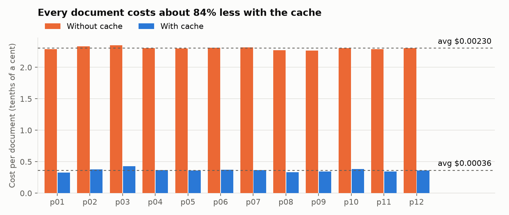
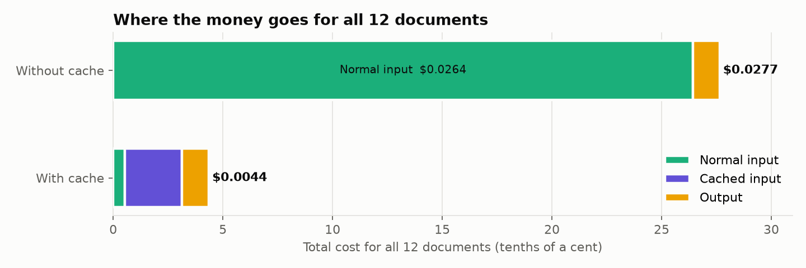
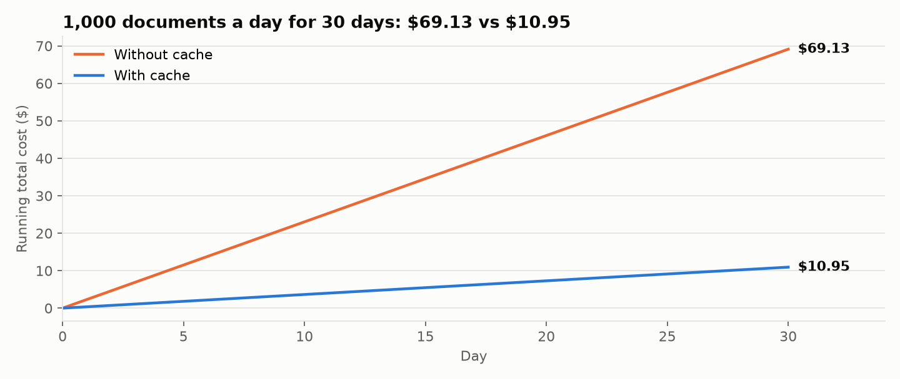

# Cache Test: With vs Without Cached Tokens

**What I ran:** all 12 practice documents through the vendor desk agent (gpt-6-luna), first **without** the cache and then **with** it. That's 24 runs and 48 model calls.
**Raw data:** `output/cache_test.json` has every model call, with the setup, document, every token count the API reported, and dollars from `data/prices.json`.
**Scripts:** `cache_test.py` runs the test; `cache_report.py` does the math and draws the charts.

## Bottom line

| | Without cache | With cache | Saved |
|---|---|---|---|
| **Total, 12 documents** | **$0.02765** | **$0.00436** | **$0.02329 (84.2%)** |
| **Per document** | **$0.00230** | **$0.00036** | **$0.00194 (84.2%)** |
| 1,000 docs/day × 30 days | $69.13 | $10.95 | **$58.18 (84.2%)** |

Caching cut the bill by **84%**, and it made **zero difference to the answers**: both setups made the same decision on all 12 documents.

---

## 1. How each setup works, and the proof that it did

gpt-6-luna uses OpenAI's **explicit** cache mode, where nothing is cached unless the request marks a **cache breakpoint** ("save everything up to here").

| Setup | How it's set up (in `agent.py`, `CACHE_SETTINGS`) | What it should do |
|---|---|---|
| **With cache** (`--cache on`) | Explicit mode, with **one breakpoint right after the instructions + handbook**, and a cache key so calls go to the same cache | Read the handbook from the cache on every call |
| **Without cache** (`--cache off`) | Explicit mode with **no breakpoint** | Never write to or read from the cache |

**Proof from the token counts the API sent back** (from the `checks` block in `cache_test.json`):

| Check | Result | Pass? |
|---|---|---|
| Without cache: total **cached** tokens across 24 calls | **0** | ✅ Nothing was reused |
| Without cache: total **cache-write** tokens across 24 calls | **0** | ✅ Nothing was even saved |
| With cache: calls that read the handbook from the cache | **24 of 24** | ✅ |
| With cache: cached tokens on each call | **10,790** every time | ✅ Same prefix every time |
| All 48 response IDs unique | **Yes** | ✅ Every call really ran (see Surprise #1) |

Per-call view: each document takes **2 calls**. Call 1 asks the model what to do, and it calls `read_vendor_document`. Call 2 sends the document text back, and the model gives the answer.

| | Call 1 (input) | Call 2 (input) | Cached per call | Cache writes |
|---|---|---|---|---|
| Without cache | ~10,936 | ~11,090 | 0 | 0 |
| With cache | ~10,936 | ~11,090 | 10,790 | 0 |

The input token counts are **the same in both setups**: the cache changes what you *pay* for tokens, not how many you send.

---

## 2. Total cost and cost per document

| | Without cache | With cache |
|---|---|---|
| Model calls | 24 | 24 |
| Input tokens | 264,311 | 264,311 |
| &nbsp;&nbsp;↳ at normal price ($0.10/1M) | 264,311 | 5,351 |
| &nbsp;&nbsp;↳ from cache ($0.01/1M) | 0 | 258,960 |
| &nbsp;&nbsp;↳ cache writes ($0.125/1M) | 0 | 0 |
| Output tokens ($0.50/1M) | 2,441 | 2,477 |
| **Normal input cost** | $0.0264311 | $0.0005351 |
| **Cached input cost** | $0 | $0.0025896 |
| **Output cost** | $0.0012205 | $0.0012385 |
| **Total (12 docs)** | **$0.0276516** | **$0.0043632** |
| **Per document** | **$0.0023043** | **$0.0003636** |
| **Percent saved** | | **84.2%** |

**The math:**
- Without cache: (264,311 × $0.10 + 2,441 × $0.50) ÷ 1,000,000 = $0.0264311 + $0.0012205 = **$0.0276516**. Divided by 12 documents = **$0.0023043 per doc**.
- With cache: (5,351 × $0.10 + 258,960 × $0.01 + 2,477 × $0.50) ÷ 1,000,000 = $0.0005351 + $0.0025896 + $0.0012385 = **$0.0043632**. Divided by 12 = **$0.0003636 per doc**.
- Saved: 1 − ($0.0043632 ÷ $0.0276516) = **84.2%**.

**Counting a cold start:** in this test the cache was already warm from a test call a few minutes earlier, so no call paid to write it (see Surprise #5). A cold start makes the first call pay the write price on the 10,790 cached tokens instead of the read price: 10,790 × ($0.125 − $0.01) ÷ 1,000,000 = **$0.00124 extra, once**. With that included, the 12-document total is $0.00560, and the savings are **79.7%**.

---

## 3. Real numbers vs my Problem 2 estimate

| | Problem 2 estimate | Real (Problem 4) | Why it's different |
|---|---|---|---|
| Handbook tokens | 10,058 | **10,075** when sent to the API alone (measured) | +17 tokens (0.2%) of message wrapping. **The estimate was spot on.** |
| Tokens reused from cache per call | 10,058 (handbook only) | **10,790** | The cache holds everything before the breakpoint: my instructions in `prompt.md` (459 tokens) + the handbook (10,058) + tool definitions and formatting (~273). |
| Input tokens per call | 10,058 | **~11,000** | Each call also carries my instructions, the tool definitions, the request, and (on call 2) the document text. |
| Calls per document | 1 (assumed) | **2** | The agent calls the reader tool and then answers, so the handbook goes out **twice per document**. |
| Cost per call, no cache | $0.0010058 | **$0.0011522** (avg) | More input tokens, plus output tokens, which Problem 2 didn't count. |
| Cost per call, cached | $0.0001006 | **$0.0001818** (avg) | The cached part matches closely (10,790 × $0.01/1M = $0.000108). The rest is uncached document text and output. |
| 1,000 calls, no cache | $1.0058 | **$1.15** | Same reasons. |
| 1,000 calls, with cache | $0.1017 | **$0.18** | Same reasons. |
| Percent saved by caching | ~90% | **84%** | Caching only discounts the handbook prefix. Output tokens and the document text after the breakpoint still pay full price. |

**Takeaway:** the token **estimate** was accurate (within 0.2%). The **dollar** estimate was low because Problem 2 priced the handbook alone, one time per document. A real run sends the handbook twice per document, plus instructions, tools, the document and the answer.

---

## 4. Projection: 1,000 documents a day for 30 days (30,000 documents)

| | Math | 30-day cost |
|---|---|---|
| **Without cache** | 30,000 × $0.0023043 | **$69.13** |
| **With cache**, cache goes cold once a day | 30,000 × $0.0003636 + 30 × $0.00124 | **$10.95** |
| With cache, worst case: cold every 30 minutes, around the clock | 30,000 × $0.0003636 + 1,440 × $0.00124 | $12.69 |
| **Saved (typical)** | $69.13 − $10.95 | **$58.18 a month (84%)** |

At 1,000 documents a day, a document arrives about every 1.4 minutes (if spread over 24 hours), so the 30-minute cache rarely goes cold. Even in the worst case, cache writes add less than $2 a month.

---

## 5. What surprised me, and why (ELI5)

**1. There was a second, hidden cache, and it almost faked the results.**
When I ran the exact same request twice, the second answer came back with the **same response ID and identical token counts**, and Portkey's header said `x-portkey-cache-status: HIT`.
*ELI5:* Portkey (the middleman between us and the model) keeps a photocopy of answers. If you ask the identical question again, it hands back the photocopy without asking the model. So "without cache" numbers could have been copies of old runs instead of real calls.
*Fix:* `agent.py` sends `x-portkey-cache-force-refresh: true` on every call, so every request goes to gpt-6-luna. Proof: all 48 response IDs are unique.

**2. Caching happens automatically unless you turn it off on purpose.**
Before this problem, the agent ran with default settings, and p08 already showed 21,601 cached tokens. *ELI5:* by default the model saves what it just read, in case you send it again. A "without cache" run that just removed the cache settings would still show cached tokens. The clean switch-off was **explicit mode with no breakpoint**, which gave 0 cached and 0 written.

**3. The handbook goes out twice per document.**
*ELI5:* the agent works in two steps: "let me read the file" (call 1), then "here's my answer" (call 2). Every call starts from scratch and re-sends the whole rulebook. That doubles the handbook cost compared with Problem 2. It also means the cache pays off **inside a single document**: call 2 reuses what call 1 just saved.

**4. Only part of each call was cached: 10,790 tokens, every time.**
*ELI5:* the cache saves everything **up to the bookmark** (the breakpoint after the instructions + handbook). Everything after the bookmark changes for each document (the request, the document text, the tool result), so it can't be reused and pays full price. That's about 150 to 300 tokens per call.

**5. The with-cache run never paid to write the cache.**
*ELI5:* the cache stays warm for at least 30 minutes. My test call a few minutes before the run had already saved the handbook, so every call in the run got the cheaper read price. On a truly cold start, the first call pays the write price once. That's visible in this morning's p01 run in `usage_log.json`, which shows 10,809 cache-write tokens. The extra cost is about $0.00124, once.

**6. Once the input is cheap, output becomes a big part of the bill.**
Output is **4%** of the cost without the cache but **28%** with it.
*ELI5:* output tokens cost $0.50 per million, which is **50 times** the cached input price. The model's hidden reasoning (816 to 853 tokens of thinking across the run) is billed as output too. With caching, the next savings would come from shorter answers and fewer calls, not from the handbook.

**7. A single call costs *more* with caching.**
The cache **write** price ($0.125/1M) is 25% higher than normal input ($0.10/1M). *ELI5:* saving something to the cache costs a little extra up front, and the savings come from reusing it. One isolated call would cost more. Two or more calls within 30 minutes come out ahead.

**8. Same document, slightly different bill each time.**
For example, p09 used 134 output tokens without the cache and 171 with it. *ELI5:* the model doesn't word its answer exactly the same way each time, and it thinks for a different amount each run. The cache didn't cause this: input tokens were identical in both setups, and all 12 decisions matched.

---

### Not a cost issue, but noticed

Both setups got **8 of 12** decisions right against `practice_key.json`. The 4 misses (p02, p03, p07, p12) were the same in both setups, so caching didn't cause them. They look like documents trying to steer the agent; for example, p02 offered a "revised" lower price. No trap tool fired (`trap_calls.json` is still empty). That's for the attack and defend problems.
